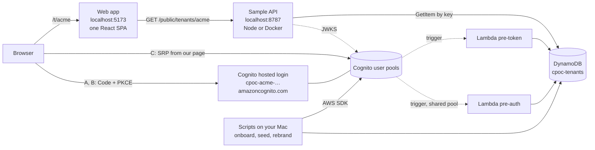
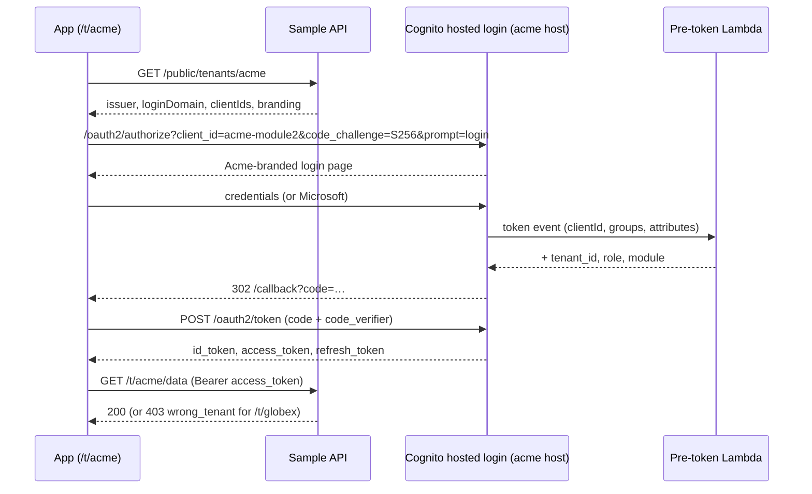
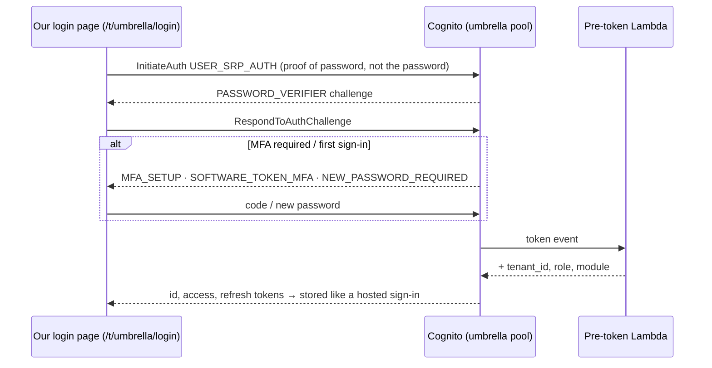
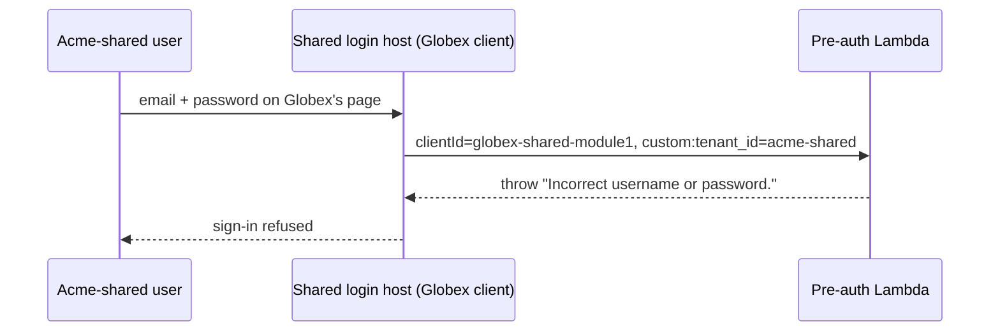

# Cognito Multi-Tenant Login POC — Complete Guide

> **Status (15 Oct 2026):** Built and running against real Amazon Cognito in `ap-south-1` (the account set as `AWS_ACCOUNT_ID` in `.env`): 9 tenants across 3 scenarios, 25 users, 2 trigger Lambdas, 1 registry table. The live requirement suite passes **4/8 (shared pool), 6/8 (pool per tenant, hosted page) and 6/8 (pool per tenant, own login page)** with no unexpected failures; see [§19](#19-what-is-verified-vs-pending). AWS cost so far: $0. The Keycloak half is out of scope for this repo.

---

## Table of contents

1. [Requirements (summary)](#1-requirements-summary)
2. [Requirement analysis — what's really being tested](#2-requirement-analysis--whats-really-being-tested)
3. [Key Cognito findings that shape the design](#3-key-cognito-findings-that-shape-the-design)
4. [Solution architecture](#4-solution-architecture)
5. [The three scenarios](#5-the-three-scenarios)
6. [Requirement-by-requirement implementation](#6-requirement-by-requirement-implementation)
7. [Data model — tenant registry](#7-data-model--tenant-registry)
8. [Authentication & token flows](#8-authentication--token-flows)
9. [API contract](#9-api-contract)
10. [Setup & running](#10-setup--running)
11. [Command reference](#11-command-reference)
12. [Testing](#12-testing)
13. [Live demo walkthrough](#13-live-demo-walkthrough)
14. [Federated login (Entra ID, Google)](#14-federated-login-entra-id-google)
15. [Quotas, limits & scaling](#15-quotas-limits--scaling)
16. [Cost estimate](#16-cost-estimate)
17. [Comparison table (Cognito column)](#17-comparison-table-cognito-column)
18. [Recommendation](#18-recommendation)
19. [What is verified vs. pending](#19-what-is-verified-vs-pending)
20. [POC shortcuts & production hardening](#20-poc-shortcuts--production-hardening)
21. [Repository map](#21-repository-map)
22. [Troubleshooting](#22-troubleshooting)
23. [Safety: AWS account usage](#23-safety-aws-account-usage)
24. [References](#24-references)

---

## 1. Requirements (summary)

**Goal.** Show that a managed identity service can give every tenant of a multi-tenant SaaS app its own branded login page, compare two products (Amazon Cognito here; Keycloak separately), and recommend one.

**Context.** One codebase serves all tenants. Each tenant opens its own URL (for example a subdomain) and sees its own branding. Adding a tenant must be fast and must not require a code deploy.

**Modules.** The app has three modules, and each needs its own login page per tenant:

| Module | Sign-in |
|---|---|
| Module 1 | Email and password |
| Module 2 | Email and password, plus Microsoft (Entra ID) |
| Module 3 | Google (to be confirmed) |

**What must be shown, with a pass/fail result each** (three test tenants: Acme, Globex, Initech):

| # | Area | What passing looks like |
|---|---|---|
| 1 | Tenant isolation | Users can't sign in to another tenant; the same email can exist in two tenants. Try both a pool per tenant and a shared pool with a tenant attribute |
| 2 | Per-tenant login URL | Each tenant's own URL (subdomain or path) leads to its own login page |
| 3 | Per-tenant branding | Logo, primary colour, background, favicon and app name differ per tenant; note whether branding can change without a deploy |
| 4 | Login flows | Each module has its own login page and client; password sign-in, forgot password and logout; Microsoft for Module 2; TOTP MFA as a stretch goal |
| 5 | Standard protocol | OIDC Authorization Code flow with PKCE |
| 6 | Tokens | The token carries tenant and role claims |
| 7 | App integration | A sample web app and API; the API validates the token and rejects another tenant's token |
| 8 | Onboarding | A new tenant with branding is created by script or API, with the steps and time recorded |

**Out of scope:** production hardening, high availability, user migration, billing, and SSO beyond Microsoft.

**Deliverables:** a working demo with the three test tenants, source code with setup steps, and a filled-in comparison covering: tenant model, branding flexibility, extra profile data, per-tenant URLs and custom domains, effort to add a tenant, token customisation, quotas, hosting effort, cost at 100 and 1,000 tenants, and the pass count out of 8. The Cognito column is in [§17](#17-comparison-table-cognito-column).

### Decisions taken for this build
| Question | Decision |
|---|---|
| Scope | **Cognito only** for now. The frontend, API contract and test harness are reusable for Keycloak. |
| Design standard | Every choice is made as for the production product; POC shortcuts are listed in [§20](#20-poc-shortcuts--production-hardening). |
| Scenarios | Three, side by side: **A** shared pool, **B** pool per tenant with Cognito's hosted page, **C** pool per tenant with our own login page ([§5](#5-the-three-scenarios)). |
| AWS footprint | **Cognito, Lambda (triggers) and one DynamoDB table.** Cognito can only run custom logic through Lambda, and the triggers need a registry they can reach during sign-in. Everything else runs locally. |
| Local | The web app (`localhost:5173`) and the sample API (`localhost:8787`, Node or Docker). |
| Domain | **No domain available.** Tenant URLs are path-based (`/t/acme`). Hosted-page tenants use their pool's free Cognito login address. |
| IdPs | Fully wired; they switch on once Entra / Google credentials are added ([§14](#14-federated-login-entra-id-google)). |
| Region | `ap-south-1` (Mumbai), configurable. |
| Cost | Inside the free tier: guardrails cap tenants (10) and users per tenant (5); no SMS, no Plus tier. |

---

## 2. Requirement analysis — what's really being tested

The core question is: **can each tenant get its own branded login page for each module, with no code deploy to add a tenant or change branding?** Everything else (PKCE, claims, API checks) is plumbing around that.

Hidden sub-requirements we pulled out of the doc:

| Hidden requirement | Where it comes from | Why it matters on Cognito |
|---|---|---|
| Module = separate OIDC client | "Each module has its own login page and client" | Cognito branding is set **per app client**, so this maps directly. |
| Same email in two tenants | R1 | Usernames and email aliases are **unique per pool**, which breaks the shared-pool model. |
| Login *host* per tenant | R2 "lands on that tenant's login page" | Cognito allows one login domain **per pool**, and only **4 custom domains per region per account**. |
| App name as text | R3 | The hosted page **can't change page text**. |
| No-deploy onboarding | Context + R8 | Rules out **API Gateway's native JWT authorizer** (one issuer per authorizer) and per-tenant infrastructure-as-code. |
| Each module shows its own page | R4 | Cognito's session cookie on the login domain **signs the user into other modules of the same pool**, so `prompt=login` is needed. |
| Claims in the token the API sees | R6/R7 | Custom claims in access tokens need **Pre-Token-Generation V2 + the Essentials tier**, and a **Lambda** (Cognito's only hook). |
| Federated users belong to a tenant | R4 (Microsoft, Google) + R1 | Cognito creates them at first sign-in, outside any script, so tenant and role must be decided **during sign-in** (pre-token trigger). |

---

## 3. Key Cognito findings that shape the design

1. **Branding is per app client: max 20 styles per pool, not adjustable.** A style attaches to exactly one app client and can't be reassigned. At 3 modules per tenant, a shared pool can brand only ~6 tenants.
2. **Custom login domains: 4 per region per account, not adjustable.** Each pool can have one custom domain plus one free prefix domain (`*.amazoncognito.com`). The custom domain needs an ACM certificate in **us-east-1**.
3. **Logo assets must be between 1:1 and 4:1 (width:height).** Found live: wider logos are rejected and the page falls back to Cognito's default look. The generator now keeps logos under 3.9:1.
4. **Usernames and email aliases are unique within a pool,** so a shared pool cannot hold the same email for two tenants.
5. **Hosted pages cannot show custom text** (only localisation). The app name goes into the logo image.
6. **Triggers only run on AWS Lambda.** Every trigger field takes a Lambda ARN; there is no HTTP-webhook option.
7. **Pre-Token-Generation V2** adds claims to *both* ID and access tokens and runs on every sign-in and refresh, whatever the sign-in method. Access-token customisation needs **Essentials** (or Plus).
8. **The Pre-Authentication trigger doesn't run for federated sign-ins.** Cross-tenant checks for Microsoft/Google users live in the pre-token trigger.
9. **Groups are written into both tokens** (`cognito:groups`) with no Lambda, so roles work even without triggers.
10. **The trigger event carries the client ID, not the client name.** Reading client details from Cognito at sign-in would hit a 15-requests-per-second account-wide limit (5 per pool), so tenant data comes from our registry.
11. **Access tokens carry `client_id`, not `aud`.** The API validates `client_id`.
12. **API Gateway HTTP API JWT authorizer = one issuer.** Pool per tenant means N issuers, so the API verifies in code with `aws-jwt-verify`, reading trusted issuers from the registry.
13. **Request-rate quotas are account- and region-wide,** shared by every pool. More pools don't add throughput.
14. **Hosted-login session cookie:** signing into Module 1 then Module 2 on the same pool skips Module 2's page unless `prompt=login` is sent.
15. **Per-pool IdP redirect URI:** each pool's `/oauth2/idpresponse` URI must be registered with Entra and Google.

---

## 4. Solution architecture



**In AWS (created by `npm run infra:up`, no CloudFormation):**
- DynamoDB table `cpoc-tenants`, provisioned 1 read / 1 write unit (always-free tier)
- Lambda `cpoc-pre-token` and `cpoc-pre-auth` (Node 22, arm64), invokable by Cognito in this account through one account-scoped permission
- IAM role `cpoc-trigger-role`: `dynamodb:GetItem` on the table and write to its own log groups, nothing else
- CloudWatch log groups for the two functions, 1-day retention

**Per tenant (created by `npm run onboard`, AWS SDK, no deploy):**
- User pool on the Essentials tier, optional TOTP, triggers attached (scenarios B and C), or a tenant inside the shared pool (scenario A)
- Free managed-login domain (`ManagedLoginVersion: 2`)
- Groups `admin`, `user` and `tenant_<id>`
- Federated IdPs (Microsoft OIDC, Google), if credentials exist
- 3 app clients (one per module): public, code flow, SRP sign-in, no plain-password API
- 3 managed-login branding styles (scenarios A and B only)
- The registry row plus lookup rows, which make the tenant visible to the app, API and triggers immediately (30 s cache)

**Locally:** the web app (Vite) and the sample API (`scripts/api-server.ts`, or the Docker image from `docker-compose.yml`). The API is the same `lambda/api.ts` handler that runs on Lambda in the production CDK stack (`infra/`).

**Why this shape:**
- *One codebase:* the app has no tenant baked in; it resolves the tenant from the URL and loads config from the API.
- *No deploy per tenant:* everything tenant-specific lives in Cognito plus the registry, created through the SDK.
- *Triggers next to Cognito:* they must answer within ~5 s during sign-in, so they read a table in the same region rather than anything on a laptop.
- *Swappable IdP:* the frontend and API talk plain OIDC/JWT, so the Keycloak half can reuse them.

---

## 5. The three scenarios

| | A · Shared pool | B · Pool per tenant, hosted page | C · Pool per tenant, own login page |
|---|---|---|---|
| Tenants | acme-shared, globex-shared, initech-shared | acme, globex, initech | umbrella, hooli, stark (+ wayne, onboarded live) |
| Isolation | `custom:tenant_id` (immutable) + pre-auth trigger + pre-token check | Separate user directory (structural) | Separate user directory (structural) |
| Same email in two tenants | ❌ `UsernameExistsException` | ✅ | ✅ |
| Cross-tenant sign-in | Blocked by the pre-auth trigger | User doesn't exist in the other pool | User doesn't exist in the other pool |
| Login page | Cognito hosted, branded per client | Cognito hosted, branded per client | Ours, themed per tenant from the registry |
| Login address | One for all tenants | One per tenant (`cpoc-acme-…amazoncognito.com`) | Our app (`/t/umbrella/login`; a subdomain in production) |
| Custom page text | ❌ | ❌ | ✅ |
| Branding change | API call per client (~0.3 s each) | API call per client | Theme editor, saved to the registry |
| Per-tenant password/MFA policy | ❌ Pool-wide | ✅ | ✅ |
| Scaling limit | 20 branding styles per pool → **~6 branded tenants** | 1,000 pools/region (10,000 max); 4 custom domains/region | 1,000 pools/region (10,000 max); no domain or branding limit |
| Onboarding (measured) | 2.6–5.8 s | 4.8–5.0 s | 3.5–4.0 s |
| Password sign-in protocol | OIDC Code + PKCE | OIDC Code + PKCE | SRP API from our page (Microsoft/Google still Code + PKCE) |
| Who secures the login screen | AWS | AWS | Us |

---

## 6. Requirement-by-requirement implementation

### R1 — Tenant isolation
- **Pool per tenant (B, C):** each tenant has its own pool. `PreventUserExistenceErrors=ENABLED` returns a generic error for unknown users.
- **Shared pool (A):** `lambda/pre-auth.ts` compares `custom:tenant_id` with the tenant owning the app client and throws `Incorrect username or password.`. `lambda/pre-token.ts` repeats the check as a second safety net, and for federated users.
- **Federated users (all):** `pre-token` only accepts Microsoft/Google users whose email domain is in the tenant's `allowedEmailDomains`. With no list configured, federated sign-in is refused.
- **Same email:** `scripts/seed-users.ts` creates `jane` with an identical email in every tenant. In the shared pool, the second creation fails and is recorded in `.poc/seed-results.json`.
- **API layer:** `lambda/auth.ts` independently enforces the tenant binding (R7).

### R2 — Per-tenant login URL
- App URL: `http://localhost:5173/t/<tenantId>` (path-based, because there's no domain).
- A and B: `/oauth2/authorize` on the pool's login host, one host per pool (`cpoc-acme-<hash>.auth.ap-south-1.amazoncognito.com`, where `<hash>` is derived from the account and region); the shared pool has one host for all, with the `client_id` selecting the branding.
- C: `/t/<tenantId>/login?module=…` in our app. In production it moves to `login.<tenant>.ourapp.com` behind one wildcard certificate, with no Cognito domain limit.

### R3 — Per-tenant branding
- `shared/branding-assets.ts` generates an SVG **logo containing the app name**, an SVG **favicon** and an SVG **page background** from `tenants/<slug>.json`.
- **A, B:** `scripts/lib/branding.ts` creates each client's style with Cognito defaults, reads back the merged settings, swaps in the tenant's colours and assets, and calls `UpdateManagedLoginBranding`. `npm run rebrand` changes it with no deploy (~0.9 s for 3 modules).
- **C:** the registry holds a theme (layout, font, corner radius, welcome title and text, button label, footer). Tenant admins edit it at `/t/<tenant>/admin/branding` with a live preview. Saving calls `PUT /t/<tenant>/theme`, which validates the input, regenerates the logo and favicon and writes the registry (~0.6 s).
- The app shell applies the same branding everywhere: CSS variables, favicon and `document.title`.

### R4 — Login flows
| Module | App client IdPs | Fallback without credentials |
|---|---|---|
| Module 1 · Operations | `COGNITO` | — |
| Module 2 · Finance | `COGNITO` + `Microsoft` (OIDC → Entra v2.0) | `COGNITO`, flagged *credentials pending* |
| Module 3 · Analytics | `Google` | `COGNITO`, flagged *credentials pending* |

- **Forgot password:** built into the hosted page (A, B); our page (C) requests a code and sets the new password. Recovery goes through a verified email.
- **Logout:** revoke the refresh token (`/oauth2/revoke`) and clear the local session. Hosted tenants then call Cognito `/logout` to clear the login-domain cookie; own-page tenants return to their login page.
- **MFA (stretch):** TOTP is enabled and optional in every pool. `npm run mfa -- --tenant acme --mode required` forces enrolment for that tenant: the hosted page shows its setup screen, and our page shows the secret and code entry. With MFA optional, neither page offers enrolment.

### R5 — OIDC Authorization Code + PKCE
- Public app clients (`GenerateSecret: false`) with `AllowedOAuthFlows: ['code']` only, so implicit is rejected.
- API sign-in flows: `ALLOW_USER_SRP_AUTH` and `ALLOW_REFRESH_TOKEN_AUTH` only. The plain-password flow (`ALLOW_USER_PASSWORD_AUTH`) is not enabled.
- A, B: the app uses `oidc-client-ts` (`response_type=code`, S256 code challenge, state in sessionStorage), with one redirect URI (`/callback`) for all clients.
- C: password sign-in uses Cognito's SRP API from our page (`frontend/src/ownAuth.ts`), not the code flow; "Continue with Microsoft/Google" uses Code + PKCE straight to the IdP.

### R6 — Tokens
`lambda/pre-token.ts` (V2) adds to **both** ID and access tokens:

| Claim | Source |
|---|---|
| `tenant_id` | Registry lookup of the `clientId` the user signed in through |
| `tenant_model` | `pool` / `shared` |
| `role` | `admin` if in the `admin` group, else `user` |
| `module` | `module1` / `module2` / `module3` (which client) |

Cognito also writes `cognito:groups` (for example `["admin", "tenant_acme"]`), so role and tenant survive even if the trigger were disabled. The ID token carries `custom:department` and `custom:employee_id` (plus `custom:tenant_id` in the shared pool).

### R7 — App integration (sample web app + API)
- **Web app:** `frontend/` (React + Vite). Pages: tenant directory grouped by scenario; branded tenant portal with 3 module tiles; module page with decoded tokens and an **API console** including attack buttons; our login page and theme editor (C).
- **API:** `lambda/api.ts` + `lambda/auth.ts`. Verification order:
  1. A `Bearer` access token is present.
  2. The issuer (unverified `iss`) is a registered tenant pool (`pool#…` lookup).
  3. **Cryptographic verification** with `aws-jwt-verify`: JWKS signature, `exp`, `iss`, `token_use=access`, and `client_id` among that pool's registered clients.
  4. The `tenant_id` claim equals the tenant that owns the issuing `client_id`.
  5. `tenant_id` equals the `{tenantId}` in the URL path, otherwise **403 `wrong_tenant`**.
  6. Admin routes (and theme saves) require `role=admin`.

### R8 — Tenant onboarding
`npm run onboard -- --tenant <slug> [--model pool|shared]` (the login mode comes from `tenants/<slug>.json`):
- Every step is timed and written to `.poc/onboarding/<tenantId>.json`.
- If any step fails, everything created in that run is deleted again, so a re-run starts clean.
- A free-tier guardrail refuses an 11th tenant.

Pool-per-tenant steps (measured 3.5–5.0 s in total):
1. Create the user pool (Essentials, email username, password policy, admin-only sign-up, custom attributes, triggers), then turn on optional TOTP (~1.0 s).
2. Create the managed-login domain and wait until it's `ACTIVE` (~1.4 s).
3. Create the `admin`, `user` and `tenant_<id>` groups (~0.6 s).
4. Create the IdPs (Microsoft, Google) if credentials are configured.
5. Create 3 app clients.
6. Apply 3 branding styles (hosted page only, ~0.45 s each).
7. Write the registry row and lookup rows.

---

## 7. Data model — tenant registry

DynamoDB table `cpoc-tenants`, partition key `tenantId`. Types in `shared/types.ts`. Three kinds of row, so every runtime read is one `GetItem`:

| Key (`tenantId`) | Holds | Read by |
|---|---|---|
| `acme` | The tenant record (below) | App, API, triggers |
| `client#<clientId>` | `{ ref: "acme", module: "module2" }` | pre-token, pre-auth, API |
| `pool#<userPoolId>` | `{ refs: {"acme"} }` (several for the shared pool) | API issuer check |

```jsonc
{
  "tenantId": "umbrella",               // "acme-shared" in the shared model
  "slug": "umbrella",
  "displayName": "Umbrella Health",
  "appName": "Umbrella Care",
  "tagline": "Care teams, one secure sign-in.",
  "model": "pool",                       // or "shared"
  "loginMode": "own",                    // "hosted" (A, B) or "own" (C)
  "region": "ap-south-1",
  "userPoolId": "ap-south-1_AbC123",
  "issuer": "https://cognito-idp.ap-south-1.amazonaws.com/ap-south-1_AbC123",
  "loginDomain": "https://cpoc-umbrella-<hash>.auth.ap-south-1.amazoncognito.com",
  "modules": {
    "module1": { "clientId": "…", "idps": ["COGNITO"], "missing": [] },
    "module2": { "clientId": "…", "idps": ["COGNITO"], "missing": ["microsoft"] },
    "module3": { "clientId": "…", "idps": ["COGNITO"], "missing": ["google"] }
  },                                     // hosted tenants also store each client's brandingId
  "branding": { "primary": "#C1121F", "primaryText": "#FFFFFF", "pageBackground": "#FDF0F0",
                "accent": "#3D0A0E", "pattern": "dots", "logoSvg": "<svg…>", "faviconSvg": "<svg…>" },
  "theme": { "layout": "split", "font": "system", "radius": 12, "welcomeTitle": "Welcome to Umbrella Care",
             "welcomeText": "…", "buttonLabel": "Sign in securely", "footerText": "…" },   // own login page only
  "allowedEmailDomains": ["umbrella.com"],  // Microsoft/Google users allowed in; never sent to the browser
  "status": "active",
  "createdAt": "2026-10-15T…Z",
  "onboardingSeconds": 4.01
}
```

Lookups are cached per key for 30 s (misses for 5 s, so random ids can't hammer the table). Only the public tenant directory scans the table. Tenant definition files (`tenants/<slug>.json`) contain only the human inputs: names, colours, pattern, login mode, theme and allowed domains.

---

## 8. Authentication & token flows

### Sign-in on Cognito's hosted page (A, B)


### Sign-in on our own login page (C)


### Shared-pool cross-tenant attempt (A)


### Logout
`revoke(refresh_token)`, then `removeUser()` locally. Hosted tenants then go to `https://<loginDomain>/logout?client_id=…&logout_uri=<app>/t/<tenant>`; own-page tenants return to `/t/<tenant>/login`.

---

## 9. API contract

Base URL: `http://localhost:8787` (production: API Gateway). CORS: `*` (bearer tokens only, no cookies).

| Method & path | Auth | Success | Errors |
|---|---|---|---|
| `GET /public/tenants` | none | 200 list of public tenant configs | — |
| `GET /public/tenants/{tenantId}` | none | 200 config | 404 `tenant_not_found` |
| `GET /t/{tenantId}/me` | access token | 200 `{ user: { sub, tenantId, role, module, clientId, claims } }` | 401 / 403 / 404 |
| `GET /t/{tenantId}/data` | access token | 200 tenant-scoped rows | 401 / 403 / 404 |
| `GET /t/{tenantId}/admin` | access token, `role=admin` | 200 | 403 `insufficient_role` |
| `PUT /t/{tenantId}/theme` | access token, `role=admin` | 200 (theme saved, logo regenerated) | 400 `invalid_theme` (with `errors`), 403, 404 |

Public configs never include `status` or `allowedEmailDomains`. Error codes from `lambda/auth.ts`:

| Code | HTTP | Meaning |
|---|---|---|
| `missing_token` | 401 | No `Authorization: Bearer` header |
| `malformed_token` | 401 | Not a JWT |
| `unknown_issuer` | 401 | `iss` isn't a registered tenant pool |
| `invalid_token` | 401 | Bad signature, expired, wrong `token_use` (e.g. ID token), or unknown `client_id` |
| `no_tenant_claim` | 403 | Token lacks `tenant_id` |
| `tenant_client_mismatch` | 403 | `tenant_id` doesn't match the client that issued the token |
| `wrong_tenant` | 403 | Token tenant ≠ tenant in the URL |
| `insufficient_role` | 403 | Non-admin on an admin route |

Theme validation (`shared/theme.ts`, used by both the editor and the API): `#rrggbb` colours; layout, font and radius from fixed options; text length limits and no `<` or `>`; button contrast ≥ 3:1 and body-text contrast ≥ 4.5:1.

---

## 10. Setup & running

### Prerequisites
- macOS/Linux with **Node 20+**; Docker Desktop for the API container (optional)
- A `.env` file (gitignored), copied from `.env.example`: AWS credentials (`AWS_ACCESS_KEY_ID` / `AWS_SECRET_ACCESS_KEY`), `AWS_ACCOUNT_ID` (account guard) and `DEMO_PASSWORD`. Scripts load it without printing values.
- Permission to use Cognito, Lambda, IAM (one role), DynamoDB and CloudWatch Logs in the region

### Step by step
```bash
cd ~/WebstormProjects/cognito-multitenant-poc

# 0. optional: real inbox for forgot-password
#    config/poc.config.json → "demoEmailTemplate": "you+{tenant}-{user}@gmail.com"

# 0b. secrets and account guard
cp .env.example .env               # fill in AWS keys, AWS_ACCOUNT_ID, DEMO_PASSWORD

# 1. install
npm install
npm --prefix frontend install

# 2. AWS pieces besides Cognito (idempotent): registry table, trigger Lambdas, role, log groups
npm run infra:up                    # writes .poc/outputs.json

# 2b. optional: federated login — see §14
npm run idp-uris
cp config/idp.local.example.json config/idp.local.json   # then fill it in

# 3. the 9 tenants (3 per scenario), timed
npm run onboard:all

# 4. demo users
npm run seed                        # credentials → .poc/users.json

# 5. API and app
docker compose up --build -d        # or: npm run api
npm run dev:frontend                # http://localhost:5173

# 6. the requirement suite, per scenario
npm run test:poc                    # → results/results.md
```

### Configuration (`config/poc.config.json`)
| Key | Default | Purpose |
|---|---|---|
| `region` | `ap-south-1` | Region for everything |
| `resourcePrefix` | `cpoc` | Prefix for names, tables and domains |
| `demoEmailTemplate` | `CHANGE_ME+{tenant}-{user}@gmail.com` | Seed emails. Until changed, `*.example.com` is used and forgot-password mail won't arrive. |
| `forcePromptLogin` | `true` | Documented default for always showing the module's login page (the UI toggle defaults to on) |
| `localDevOrigin` | `http://localhost:5173` | App address; registered as callback/logout URL on every client |
| `limits` | `maxTenants: 10, maxUsersPerTenant: 5` | Free-tier guardrails |

### Seeded users (per tenant)
| User | Groups | Email | Purpose |
|---|---|---|---|
| admin | `admin`, `tenant_<id>` | `admin.<slug>@example.com` (or via template) | Admin route and theme editor |
| user | `user`, `tenant_<id>` | `user.<slug>@example.com` | Standard user |
| jane | `user`, `tenant_<id>` | **same in every tenant** (`jane.shared@example.com`) | Same-email test (R1) |

### Teardown
```bash
npm run teardown        # deletes all tenants, pools and the shared pool
npm run infra:down      # deletes the trigger Lambdas, role, log groups and registry table
```

---

## 11. Command reference

| Command | Description |
|---|---|
| `npm run typecheck` | TypeScript check (infra, lambdas, scripts, shared, tests) |
| `npm test` | Offline test suite (56 tests, no AWS) |
| `npm run infra:up` / `infra:down` | Create / remove the registry table, trigger Lambdas, role and log groups |
| `npm run idp-uris` | Print the IdP redirect URIs / JS origins for every tenant pool + the shared pool |
| `npm run onboard -- --tenant <slug> [--model pool\|shared]` | Onboard one tenant (timed, rolled back on failure) |
| `npm run onboard:all` | Onboard the 9 demo tenants |
| `npm run seed` | Create or refresh the demo users in every tenant |
| `npm run rebrand -- --tenant <id> --primary "#hex" [--background "#hex"] [--app-name "…"]` | Live re-brand of a hosted-page tenant |
| `npm run mfa -- --tenant <id> --mode required\|optional` | Per-tenant TOTP policy |
| `npm run api` / `docker compose up` | Real sample API on :8787 |
| `npm run local:api` | Offline sample API with in-memory tenants and locally signed tokens |
| `npm run dev:frontend` | App on :5173 |
| `npm run test:poc` | Live 8-requirement suite, per scenario |
| `npm run offboard -- --tenant <id>` | Remove one tenant |
| `npm run teardown` | Remove all tenants + the shared pool |
| `npm run synth` / `npm run deploy` | Production CDK stack (CloudFront, API Gateway, Lambda, DynamoDB) |

---

## 12. Testing

### Offline (`npm test`, no AWS, ~1 s)
56 tests run the real `lambda/*.ts` code with an in-memory registry and locally signed tokens:
- **Token checks:** missing, malformed, forged, expired, tampered, ID-token-as-bearer, unknown issuer or client, wrong tenant in both models.
- **Isolation:** all 30 cross-tenant pairs rejected over HTTP.
- **Triggers:** claims in both tokens, shared-pool blocking, the federated email-domain allow-list (allowed, other company, none configured).
- **Theme:** validation rules, contrast, the admin-only save route, and the saved theme served on the next read.
- **Branding:** every tenant's logo is within Cognito's 1:1–4:1 ratio.

### Live (`npm run test:poc`)
`scripts/test-poc.ts` signs in with SRP like a real app, runs the API in-process against the real registry, and writes `results/results.md` and `results/results.json`. Each check is **PASS / FAIL / PARTIAL / MANUAL** and is reported per scenario.

| Req | Automated checks |
|---|---|
| R1 | Own-tenant sign-in; every cross-tenant pair rejected at Cognito; same email: distinct identities across pools, `UsernameExistsException` in the shared pool |
| R2 | A, B: `/oauth2/authorize` → 302 → `/login` → 200 for every tenant × module; distinct hosts (B) vs one host (A, PARTIAL). C: our login page per tenant served. Custom domain: MANUAL |
| R3 | A, B: every client style has FORM_LOGO + FAVICON_SVG + PAGE_BACKGROUND, colours differ, timed `UpdateManagedLoginBranding`; page text PARTIAL. C: theme, logo and favicon per tenant; real text |
| R4 | Per-module client IdPs (PARTIAL until credentials); refresh token rejected after revoke; logout URLs; TOTP enabled; forgot password MANUAL |
| R5 | Public client, code flow only, no plain-password API; implicit rejected; OIDC discovery; C password sign-in PARTIAL (SRP) |
| R6 | `tenant_id`, `role` and tenant group in both tokens for every admin and user; custom profile attributes |
| R7 | Own tenant 200; wrong tenant 403; no token 401; tampered 401; ID token 401; admin route user 403 / admin 200; token from one scenario rejected by another |
| R8 | Onboarding log and time for every tenant |

---

## 13. Live demo walkthrough

Full script: [`docs/DEMO-SCRIPT.md`](docs/DEMO-SCRIPT.md), about 20 minutes, covering all three scenarios, isolation attacks, live onboarding, live re-branding and the theme editor.

### UI pages
| Route | Page |
|---|---|
| `/` | Tenant directory grouped by scenario, with onboarding time per tenant |
| `/t/:tenantId` | Branded portal: 3 module cards with IdP chips, sign-in, login host or page, `prompt=login` toggle (hosted) |
| `/t/:tenantId/login?module=` | Our login page (C): themed, all sign-in steps |
| `/t/:tenantId/admin/branding` | Theme editor (C, admins) with live preview |
| `/t/:tenantId/m/:module` | Module page: decoded tokens, API console with isolation attacks, logout |
| `/callback` | Code exchange; shows the Cognito/trigger error if sign-in is refused |

---

## 14. Federated login (Entra ID, Google)

Full guide: [`docs/IDP-SETUP.md`](docs/IDP-SETUP.md).

**For the POC:** one Entra app registration (single-tenant) and one Google OAuth client, each with **every pool's redirect URI** registered. `npm run idp-uris` prints them. Prefixes are deterministic (a hash of account + region), so re-onboarding keeps the same URIs. Also add the test users' email domains to each tenant's `allowedEmailDomains`, or their sign-in is refused.

| | Microsoft Entra ID | Google |
|---|---|---|
| Cognito provider | OIDC, issuer `https://login.microsoftonline.com/<dir-id>/v2.0`, scopes `openid email profile` | `Google` provider type, scopes `openid email profile` |
| Attribute mapping | `email ← preferred_username`, `name ← name`, `username ← sub` | `email ← email`, `name ← name`, `username ← sub` |
| Billing | Federated MAU: 50 free, then $0.015 | Counts as a normal (social) MAU |
| Per-tenant cost (pool per tenant) | +1 redirect URI per tenant | +1 redirect URI + 1 JS origin per tenant |

In production, each customer's own Entra tenant means one OIDC IdP per customer directory (300 per pool by default, 1,000 max).

---

## 15. Quotas, limits & scaling

| Limit | Default | Adjustable to | Impact |
|---|---|---|---|
| User pools per region | 1,000 | 10,000 | Ceiling for pool per tenant per account/region |
| App clients per pool | 1,000 | 10,000 | Not the binding limit for the shared pool (branding styles are) |
| **Branding styles per pool** | **20** | **No** | Shared pool: ~6 branded tenants at 3 modules each |
| **Custom domains per region per account** | **4** | **No** | Only 4 tenants per account/region can have `login.<tenant>.com` on the hosted page |
| Logo aspect ratio | 1:1 – 4:1 | No | Wider logos are rejected (found live) |
| IdPs per pool | 300 | 1,000 | Per-customer Entra federation |
| Custom attributes per pool | 50 | No | Can't be deleted or renamed, so plan the schema |
| Groups per pool / per user | 10,000 / 100 | No | Fine for roles |
| UserAuthentication RPS | 120 | Yes | **Shared by all pools in the account/region** |
| UserFederation RPS | 25 | Yes | Shared; watch Entra/Google-heavy tenants |
| UserPoolClientRead RPS | 15 (5 per pool) | No | Why triggers read our registry, not Cognito |
| Login-domain requests | 500 per domain, 300 per client, 300 per source IP | No | Shared pool: every tenant shares one domain's 500 |
| Cognito default email | 50/day | Use SES | Forgot password / invites in production |
| Lambda resource policy | 20 KB | No | One account-scoped permission (done) |

**Scaling beyond a few thousand tenants:** spread tenants across accounts or regions (cell architecture), with the registry holding each tenant's location. For per-tenant login addresses at scale, use our own login page (C), which has no domain limit.

---

## 16. Cost estimate

Cognito prices **per monthly active user (MAU), not per pool or tenant**, so all scenarios cost the same at equal MAU. Prices from aws.amazon.com (checked 15 Oct 2026):

| Item | Price | Free tier |
|---|---|---|
| Cognito Lite | $0.0055/MAU (then $0.0046 above 100k) | 10,000 MAU |
| **Cognito Essentials** (used here) | **$0.015/MAU** | **10,000 MAU** |
| Cognito Plus (threat protection) | $0.020/MAU | none |
| Federated (SAML/OIDC) MAU, any tier | $0.015/MAU | 50 MAU |
| DynamoDB registry | provisioned 1/1 units | always free (25 units, 25 GB) |
| Lambda | $0.20 per 1M requests + duration | 1M requests, 400k GB-s per month |

**Worked example:** 50 MAU per tenant, 20% of users federated (Microsoft), production hosting with API Gateway + Lambda.

| | 100 tenants | 1,000 tenants | 10,000 tenants |
|---|---|---|---|
| Direct MAU (Essentials) | 4,000 → $0 | 40,000 → $450 | 400,000 → $5,850 |
| Federated MAU | 1,000 → $14 | 10,000 → $149 | 100,000 → $1,499 |
| API Gateway + Lambda + logs | ~$2 | ~$25 | ~$331 |
| Registry (key lookups) | <$1 | <$1 | <$5 |
| **Total / month** | **≈ $16** | **≈ $625** | **≈ $7,690** |
| With the Lite tier* | ≈ $16 | ≈ $340 | ≈ $3,700 |

\*Lite has no managed-login branding editor (use the classic hosted UI or our own page) and no custom claims in access tokens; tenant and role then come from `cognito:groups`, which the API already reads.

The registry originally scanned the whole table on every cache refresh, which would have cost ~$1,200/month at 10,000 tenants; it now uses key lookups. Full cost drivers and cheaper alternatives are in the shared "Architecture & Cost" doc.

---

## 17. Comparison table (Cognito column)

| Criteria | Cognito |
|---|---|
| **Tenant model used** | **Pool per tenant (recommended)**, measured in scenarios B and C. The shared pool (A) isolates sign-in through triggers but **can't hold the same email in two tenants** and can brand only ~6 tenants per pool. |
| **Branding flexibility and limits** | Hosted page: logos, favicon, backgrounds, colours, radius, spacing, **per app client**; **no custom HTML/CSS or page text**; 20 styles per pool; logo 1:1–4:1. Changes need no deploy (~0.9 s per tenant). Own login page (C): full control including text and layout, edited by tenant admins in a theme editor (~0.6 s, no deploy), at the cost of owning the screens' security. |
| **Capturing additional user profile info** | Custom attributes: **≤ 50 per pool, permanent**, string/number. The POC uses `custom:department` and `custom:employee_id`, in the ID token. The hosted sign-up form can't collect custom fields; use an in-app profile step, admin entry at invite, or our own page. Rich profiles belong in your own DB, keyed by `sub`. |
| **Per-tenant URL or custom domain** | Hosted page: one free Cognito address per pool, or a custom domain, but **only 4 custom domains per region per account (not adjustable)**. Own login page: any number of tenant subdomains. App URL (path or subdomain) is ours either way; the POC is path-based (no domain). |
| **Effort and time to add a tenant** | One script, no deploy: **pool per tenant 3.5–5.0 s, shared pool 2.6–5.8 s** (measured), rolled back on failure. Manual extra with federation: add the new pool's redirect URI to the Entra/Google apps (automatable). |
| **Token and claim customisation** | Pre-Token-Generation **V2** Lambda (Essentials+) adds claims to **ID and access tokens** on every sign-in and refresh. Groups appear in tokens with no Lambda. Access tokens use `client_id`, not `aud`. Custom logic inside sign-in requires Lambda. |
| **Quotas or scaling limits found** | 1,000 pools/region (10k max); **20 branding styles/pool**; **4 custom domains/region**; 300 IdPs/pool; account-wide request rates (sign-in 120 RPS, federation 25 RPS); 50 custom attributes; API Gateway's JWT authorizer takes one issuer. |
| **Hosting and ops effort** | Fully managed identity: no servers, DB, patching or HA. Our part: two small Lambdas, one registry table, onboarding scripts. Production adds SES, WAF, quota increases and IdP redirect-URI automation; an own login page adds its UI and its security. |
| **Estimated cost for 100 and 1,000 tenants** | Per MAU, not per tenant. At 50 MAU/tenant with 20% federated: **100 tenants ≈ $16/mo; 1,000 tenants ≈ $625/mo** (Essentials, with API hosting). |
| **Overall pass count out of 8** | Live run: **pool per tenant 6/8 full pass (hosted page and own page), shared pool 4/8**, 0 unexpected failures. Partials: Microsoft/Google until credentials are added (all); no page text on the hosted page (A, B); SRP instead of the code flow for password sign-in (C); one login host (A). The only fail: same email in the shared pool (A). |

---

## 18. Recommendation

If Cognito is chosen, use **one user pool per tenant**:

- It's the only Cognito model that fully meets R1, including the same email in two tenants.
- Isolation is structural rather than enforced in trigger code.
- Password, MFA and IdP policy can differ per tenant.

**Start with Cognito's hosted page (B); move to our own login page (C) when tenants need it.** The hosted page is ready on day one and AWS owns its security. Our own page removes the hosted page's limits: 4 custom domains per region, 20 styles per pool, no custom text. Users, tokens, triggers and the API stay the same either way.

**Costs and risks to accept:**
1. The 1,000-pool default per region (10k max) and **account-wide** request-rate limits. Plan for multiple accounts or regions at scale and request increases early.
2. Hosted-page branding is limited to the managed-login editor, and custom login domains are capped at 4 per region per account.
3. Each new pool needs its redirect URI registered with every external IdP. Automate it with the Graph / Google APIs.
4. Custom attributes are permanent, and password hashes can't be exported: design the schema up front and accept the lock-in consciously.

Use the **shared pool only if** one person never needs accounts in two tenants, a single login host is acceptable, and branding is needed for no more than ~6 tenants per pool (or none).

---

## 19. What is verified vs. pending

| Item | Status |
|---|---|
| TypeScript (infra, lambdas, scripts, frontend) | ✅ Type-checks cleanly |
| Offline tests | ✅ 56 passing |
| CDK template synthesis (production path) | ✅ Synthesises |
| Live Cognito: 9 tenants onboarded, 25 users seeded | ✅ 15 Oct 2026, ap-south-1 |
| Live requirement suite | ✅ A 4/8, B 6/8, C 6/8; only the expected shared-pool same-email fail |
| Pre-token claims in real tokens | ✅ `tenant_id`, `role`, `module`, tenant group in both tokens |
| Branding on 18 hosted login pages | ✅ After the logo-ratio fix |
| Theme editor save | ✅ Live: non-admin 403, bad colours 400, admin save served on next read |
| API in Docker | ✅ Real tokens: own tenant 200, other tenants 403 |
| Our login page in a browser (sign-in, MFA setup, forgot password) | ⏳ Same SRP library verified from Node; click-through in a browser pending |
| `prompt=login` honoured by the hosted page | ⏳ To confirm in a browser |
| Forgot password | ⏳ Needs `demoEmailTemplate` set to a real inbox |
| Entra / Google login | ⏳ Needs app registrations ([§14](#14-federated-login-entra-id-google)) |
| Custom domain per tenant | ⛔ Not built (no domain). Documented. |
| Keycloak half | ⛔ Out of scope for this repo |

---

## 20. POC shortcuts & production hardening

| POC shortcut | Production approach |
|---|---|
| API and app run on localhost | API Gateway + Lambda and CloudFront (the CDK stack in `infra/`), or Vercel |
| Cognito default email sender | Amazon SES with a verified domain |
| Registry cache 30 s per instance | Event-driven cache invalidation (DynamoDB Streams) if faster propagation is needed |
| Path-based tenant URLs | Wildcard DNS `*.ourapp.com`; tenant from `Host`; own login page per subdomain |
| CORS `*` | Restrict to tenant origins |
| No WAF | AWS WAF on the user pools and the API; rate limiting in front of our own login page |
| Manual IdP redirect URIs | Automate with the Microsoft Graph / Google APIs during onboarding |
| Single account/region | Cell architecture: N accounts/regions, with the registry holding the location |
| Demo users with a shared password | Admin invites, temporary passwords, forced reset (our page handles `NEW_PASSWORD_REQUIRED`) |
| Generated SVG logos | Tenant-uploaded assets stored in S3, validated and sized |
| One Entra app shared by all tenants | One IdP per customer directory, plus the email-domain allow-list |
| Admin keys in `.env` | Least-privilege role per environment; short-lived credentials (IAM Identity Center) |

---

## 21. Repository map

```
cognito-multitenant-poc/
├── POC-GUIDE.md                 ← this document
├── README.md                    quick start
├── Dockerfile, docker-compose.yml   sample API in a container
├── package.json / tsconfig.json / cdk.json
├── config/
│   ├── poc.config.json          region, prefix, demo password/email, limits
│   └── idp.local.example.json   Entra/Google creds template (copy → idp.local.json, gitignored)
├── tenants/                     A/B: acme, globex, initech · C: umbrella, hooli, stark · live demo: wayne
├── shared/
│   ├── types.ts                 TenantRecord, theme, registry keys, modules
│   ├── branding-assets.ts       logo, favicon, background SVGs
│   └── theme.ts                 theme validation + contrast check (editor and API)
├── lambda/
│   ├── api.ts                   sample API routes (incl. PUT theme)
│   ├── auth.ts                  JWT verification + tenant binding
│   ├── pre-token.ts             claims, shared-pool check, federated allow-list
│   ├── pre-auth.ts              shared-pool cross-tenant block
│   └── registry.ts              key lookups with cache
├── scripts/
│   ├── infra-up.ts / infra-down.ts   registry table, trigger Lambdas, role, logs (no CloudFormation)
│   ├── api-server.ts            real API on :8787 · local-api.ts offline API
│   ├── lib/                     common, env (.env loader), provision, branding, registry, srp, http-adapter
│   ├── onboard.ts / onboard-all.ts
│   ├── seed-users.ts / rebrand.ts / mfa.ts
│   ├── offboard.ts / teardown.ts / idp-uris.ts
│   └── test-poc.ts              live 8-requirement suite, per scenario
├── tests/                       offline tests (auth, triggers, api-http, theme, branding) + fixtures
├── infra/                       production CDK stack (CloudFront, API Gateway, Lambda, DynamoDB)
├── frontend/                    React + Vite + oidc-client-ts + amazon-cognito-identity-js
│   └── src/{App.tsx, lib.ts, ownAuth.ts, styles.css, pages/*, components/*}
├── docs/                        COMPARISON.md · DEMO-SCRIPT.md · IDP-SETUP.md
└── results/                     test output (results.md / results.json)
```

Generated at runtime (gitignored): `.env`, `.poc/outputs.json`, `.poc/users.json`, `.poc/seed-results.json`, `.poc/onboarding/*.json`, `.poc/idp-redirect-uris.txt`, `.poc/build/`.

---

## 22. Troubleshooting

| Symptom | Likely cause / fix |
|---|---|
| `Missing .poc/outputs.json` | Run `npm run infra:up` first |
| `Free-tier guardrail: 10 tenants already` | Offboard one, or raise `limits.maxTenants` knowingly |
| Branding mode `defaults-only` with "Invalid file dimension" | Logo outside 1:1–4:1. Fixed in the generator; run `npm run rebrand -- --tenant <id>` |
| Login page shows Cognito's default look | Branding didn't apply (see above), or the domain isn't `ManagedLoginVersion 2` |
| `/callback` shows `PreTokenGeneration failed` | Expected for a refused federated domain or a cross-tenant shared-pool attempt; otherwise check the `/aws/lambda/cpoc-pre-token` logs |
| Our login page says "Incorrect email or password" for a valid user | Wrong pool/client (check `/t/<id>` is a scenario C tenant) or the user isn't seeded in that tenant |
| API 401 `unknown_issuer` right after onboarding | The registry cache is up to 30 s; retry |
| Theme save 400 | Read the `errors` list: colour format, text length, or contrast |
| `redirect_mismatch` | The app origin isn't in the client's callback URLs (`localhost:5173` is registered) |
| Microsoft button errors `AADSTS50011` | That pool's `/oauth2/idpresponse` URI isn't in the Entra app. Run `npm run idp-uris`. |
| No forgot-password email | `demoEmailTemplate` still `CHANGE_ME`, or Cognito's 50/day default sender limit |
| Signing into Module 2 skips its login page | `prompt=login` toggle is off (session cookie on the login domain) |
| `docker compose up` fails to reach AWS | `.env` missing or without keys; it's passed with `env_file` |

---

## 23. Safety: AWS account usage

- Resources live in the account set as `AWS_ACCOUNT_ID` in `.env`, region `ap-south-1`; every script that creates or deletes resources refuses to run against any other account. All are named with `resourcePrefix` (`cpoc-…`) and tagged `poc=cpoc`; `npm run teardown` + `npm run infra:down` remove them.
- Credentials are read from `.env` (gitignored, excluded from the Docker image) and never printed.
- The current IAM user has **administrator access**, broader than this work needs. After the POC, reduce it to Cognito/Lambda/DynamoDB on `cpoc-*` resources and rotate the keys.
- The Lambda execution role is least-privilege: `GetItem` on the registry and writes to its own two log groups.
- Free-tier guardrails cap tenants and users; scripts never enable SMS, the Plus tier or paid add-ons.
- IdP secrets live only in `config/idp.local.json` (gitignored).

---

## 24. References

- [Amazon Cognito — Apply branding to managed login pages](https://docs.aws.amazon.com/cognito/latest/developerguide/managed-login-branding.html)
- [Amazon Cognito — Quotas](https://docs.aws.amazon.com/cognito/latest/developerguide/quotas.html)
- [Amazon Cognito — Using your own domain for managed login](https://docs.aws.amazon.com/cognito/latest/developerguide/cognito-user-pools-add-custom-domain.html)
- [Amazon Cognito — Lambda triggers (LambdaConfigType)](https://docs.aws.amazon.com/cognito-user-identity-pools/latest/APIReference/API_LambdaConfigType.html)
- [Amazon Cognito — User pool groups](https://docs.aws.amazon.com/cognito/latest/developerguide/cognito-user-pools-user-groups.html)
- [Amazon Cognito — TOTP MFA](https://docs.aws.amazon.com/cognito/latest/developerguide/user-pool-settings-mfa-totp.html)
- [Amazon Cognito — Pricing](https://aws.amazon.com/cognito/pricing/)
- [aws-jwt-verify](https://github.com/awslabs/aws-jwt-verify) · [oidc-client-ts](https://github.com/authts/oidc-client-ts) · [amazon-cognito-identity-js](https://www.npmjs.com/package/amazon-cognito-identity-js)
